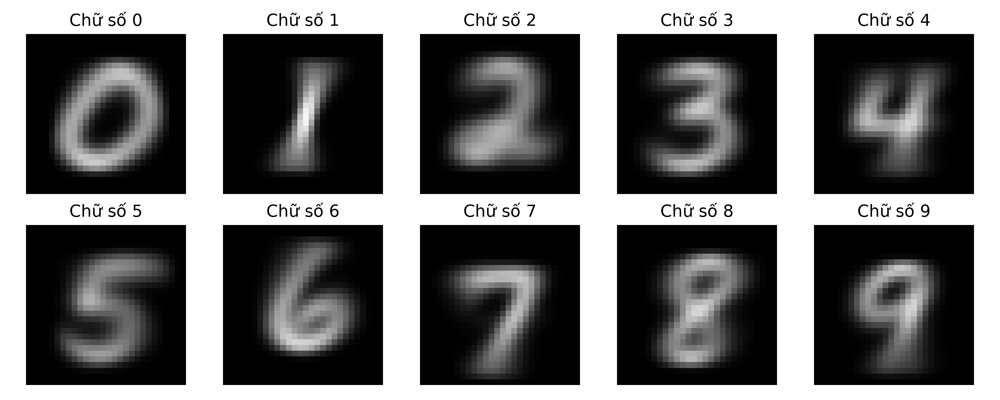
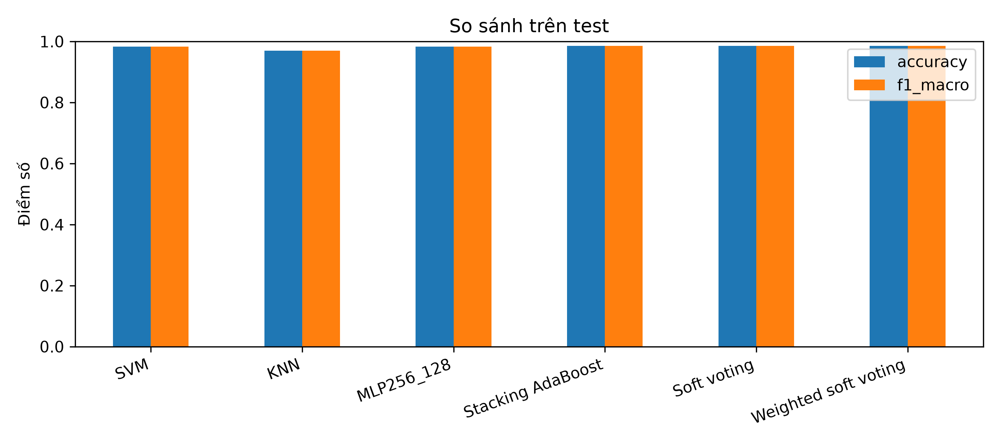

# Nhận diện chữ số viết tay MNIST

Đồ án môn **Nhận dạng mẫu** — cài đặt Gaussian Naive Bayes, Softmax Regression và MLP bằng NumPy; lựa chọn mô hình cơ sở và xây dựng stacking với AdaBoost ở tầng cuối. Phần mở rộng khảo sát CNN và ảnh hưởng của data augmentation bằng PyTorch.

- **Giảng viên:** Trương Phước Hưng
- **Repository:** [midterm_pattern_recognition](https://github.com/luyenhungtran/midterm_pattern_recognition)

| Thành viên | MSSV |
|---|---|
| Lê Mỹ Tài | 24110235 |
| Trần Hùng Luyện | 24110201 |

## Nội dung thực hiện

- Khám phá dữ liệu: phân bố lớp, cường độ pixel, ảnh trung bình và khoảng cách giữa các lớp.
- Tự cài đặt Gaussian NB, Softmax và MLP; đối chiếu với scikit-learn, khảo sát siêu tham số và phân tích lỗi.
- Đánh giá mô hình đơn, các cặp và bộ ba trên validation; phân tích mức trùng lặp lỗi và soft voting.
- Tạo dự đoán out-of-fold (OOF) bằng **5-fold StratifiedKFold** cho SVM, KNN và MLP256_128; ghép xác suất thành 30 đặc trưng cho AdaBoost meta-learner.
- So sánh MLP và CNN có số tham số gần nhau; khảo sát augmentation và độ bền với dịch chuyển, xoay ảnh.
- Minh họa suy luận và kết quả bằng ứng dụng Streamlit.

## Dữ liệu và quy trình đánh giá

MNIST gồm ảnh xám **28 × 28**, nhãn số nguyên từ **0 đến 9**. `src/data.py` tự tải bốn file IDX nén từ [nguồn MNIST](https://ossci-datasets.s3.amazonaws.com/mnist/) vào `data/raw/` khi chưa có dữ liệu.

| Tập | Số ảnh | Vai trò |
|---|---:|---|
| Train | 50.000 | Huấn luyện |
| Validation | 10.000 | Khảo sát cấu hình, lựa chọn mô hình/checkpoint |
| Test | 10.000 | Báo cáo kết quả cuối |

Các notebook chia phân tầng từ 60.000 ảnh train gốc với `random_state=42`. Pixel được chuyển sang `float32` và chia cho 255; mô hình dạng vector nhận 784 đặc trưng, CNN nhận tensor `(N, 1, 28, 28)`. Không chuẩn hóa z-score trong pipeline hiện tại.

**Lưu ý API:** `load_prepared_mnist()` chỉ trả về bốn mảng train gốc/test đã tiền xử lý; việc tách validation được thực hiện trong notebook. Notebook 05 còn tách một tập tuning nội bộ từ 50.000 ảnh train.

Độ đo gồm accuracy, precision macro, recall macro, F1 macro, confusion matrix và thời gian. Thời gian phụ thuộc phần cứng, phiên bản thư viện và cấu hình chạy; kết quả một seed chưa đủ để kết luận ưu thế có ý nghĩa thống kê.

## Cấu trúc dự án

| Đường dẫn | Nội dung |
|---|---|
| `src/config.py` | Đường dẫn gốc và dữ liệu |
| `src/data.py` | Tải MNIST, đọc IDX, chuẩn hóa và flatten |
| `src/models/gaussian.py` | Gaussian Naive Bayes tự cài đặt |
| `src/models/softmax.py` | Softmax Regression tự cài đặt |
| `src/models/mlp.py` | MLP NumPy với feedforward/backpropagation thủ công |
| `notebooks/` | EDA, huấn luyện, khảo sát và đánh giá |
| `app/app.py` | Giao diện Streamlit |
| `data/raw/` | Dữ liệu tải về; không theo dõi bằng Git |
| `results/` | CSV, cấu hình JSON, biểu đồ, chỉ số chia tập và mô hình đã lưu |
| `report/bao_cao.pdf` | Báo cáo |
| `report/Slide.pptx` | Slide thuyết trình |
| `requirements.txt` | Danh sách thư viện và phiên bản của môi trường cung cấp |

## Cài đặt

Clone repository và tạo môi trường riêng:

```bash
git clone https://github.com/luyenhungtran/midterm_pattern_recognition.git
cd midterm_pattern_recognition
python -m venv .venv
```

Kích hoạt môi trường trên Windows PowerShell:

```powershell
.\.venv\Scripts\Activate.ps1
```

Hoặc trên Linux/macOS:

```bash
source .venv/bin/activate
```

Cài thư viện và đăng ký kernel cho VS Code/Jupyter:

```bash
python -m pip install --upgrade pip
python -m pip install -r requirements.txt
python -m ipykernel install --user --name mnist --display-name "Python (mnist)"
```

Mở notebook trong VS Code và chọn kernel **Python (mnist)**. Danh sách requirements là bản khóa phiên bản được cung cấp cùng dự án; chưa được kiểm chứng bằng cài đặt sạch trong lần cập nhật README này. Không có đủ metadata để khẳng định một phiên bản Python cụ thể đã được kiểm thử. Python cần hỗ trợ cú pháp type hint `tuple[int, ...]` và có bản phân phối tương thích với toàn bộ phiên bản đã khóa.

## Thứ tự chạy notebook

Chạy từ thư mục gốc hoặc `notebooks/`, dùng **Run All** trong từng notebook.

| Thứ tự | Notebook | Nội dung / đầu ra |
|---:|---|---|
| 01 | [01_eda.ipynb](notebooks/01_eda.ipynb) | EDA → `results/eda/` |
| 02 | [02_gauss_naive_bayes.ipynb](notebooks/02_gauss_naive_bayes.ipynb) | Gaussian NB → `results/gaussian/` |
| 03 | [03_softmax.ipynb](notebooks/03_softmax.ipynb) | Softmax → `results/softmax/` |
| 04 | [04_mlp.ipynb](notebooks/04_mlp.ipynb) | MLP NumPy và sklearn → `results/mlp/` |
| 05 | [05_select_base_models.ipynb](notebooks/05_select_base_models.ipynb) | Chọn mô hình và bộ ba → `results/select_base_models/` |
| 06 | [06_stacking_adaboost.ipynb](notebooks/06_stacking_adaboost.ipynb) | Đọc cấu hình/estimator từ 05, tạo OOF và huấn luyện stacking → `results/stacking_adaboost/` |
| 07 | [07_comparison.ipynb](notebooks/07_comparison.ipynb) | Tổng hợp kết quả; cần đồng bộ đầu vào như lưu ý bên dưới |
| 08 | [08_cnn_mlp.ipynb](notebooks/08_cnn_mlp.ipynb) | MLP260 và CNN_FC128 → `results/cnn_mlp/` |
| 09 | [09_cnn_mlp_augmentation_one_seed.ipynb](notebooks/09_cnn_mlp_augmentation_one_seed.ipynb) | Augmentation, robustness với seed 42 → `results/cnn_mlp_augmentation/` |

**Phụ thuộc bắt buộc:** chạy 05 trước 06. Nếu thay đổi cấu hình hoặc cách chia tập trong 05, cần chạy lại 06 để tránh trộn kết quả. Chạy lại notebook có thể ghi đè kết quả cùng tên; nên lưu bản kết quả cần giữ trước khi chạy.

## Kết quả đã lưu

Bảng dưới lấy trực tiếp từ kết quả của từng thí nghiệm trong bản dự án cung cấp, không lấy từ bảng tổng hợp cũ ở `results/comparison/`. Accuracy biểu diễn theo %, F1 macro theo thang [0, 1].

| Mô hình | Test accuracy (%) | Test F1 macro | Nguồn trong `results/` |
|---|---:|---:|---|
| Gaussian NB NumPy | 77,53 | 0,7716 | `gaussian/test_metrics.csv` |
| Gaussian NB sklearn | 81,47 | 0,8131 | `gaussian/test_metrics.csv` |
| Softmax NumPy | 92,53 | 0,9241 | `softmax/metrics.csv` |
| Softmax sklearn | 92,41 | 0,9230 | `softmax/metrics.csv` |
| MLP NumPy | 98,19 | 0,9818 | `mlp/final_comparison.csv` |
| MLP sklearn | 98,41 | 0,9840 | `mlp/final_comparison.csv` |
| SVM cơ sở | 98,33 | 0,9832 | `stacking_adaboost/metrics.csv` |
| Soft voting | 98,52 | 0,9852 | `stacking_adaboost/metrics.csv` |
| Stacking AdaBoost | 98,54 | 0,9854 | `stacking_adaboost/metrics.csv` |
| MLP260 (50 epoch) | 97,57 | 0,9755 | `cnn_mlp/metrics.csv` |
| CNN_FC128 (50 epoch) | 98,70 | 0,9870 | `cnn_mlp/metrics.csv` |

Gaussian NB tự viết và sklearn dùng `var_smoothing` khác nhau (0,001 và 0,1), nên hai hàng này không phải phép đối chiếu với cấu hình đồng nhất. MLP NumPy và sklearn cũng dùng hệ số L2 khác nhau; cần đọc `config.json` trước khi diễn giải chênh lệch.

Stacking dùng AdaBoost với `learning_rate=0.2`, cây sâu 2, 100 estimator. Validation accuracy đạt 98,53%; test accuracy hơn soft voting **0,02 điểm phần trăm**, tương đương **2 ảnh**. Chênh lệch nhỏ này chưa chứng minh stacking vượt trội ổn định.

Thí nghiệm augmentation riêng chạy 15 epoch cho kết quả clean test:

| Mô hình | Không augmentation | Có augmentation |
|---|---:|---:|
| MLP260 | 95,98% | 87,63% |
| CNN_FC128 | 98,57% | 98,24% |

Nguồn: [cnn_mlp_augmentation/metrics.csv](results/cnn_mlp_augmentation/metrics.csv). Augmentation trong cấu hình này không cải thiện accuracy trên clean test. Không so trực tiếp mức giảm với thí nghiệm 50 epoch vì ngân sách huấn luyện khác nhau.





## Chạy ứng dụng minh họa

Từ thư mục gốc:

```bash
python -m streamlit run app/app.py
```

App đọc mô hình và kết quả đã lưu, không tự huấn luyện. Các file cần cho suy luận:

| Phương pháp | File mô hình | Cách tạo lại |
|---|---|---|
| Gaussian NB | `results/gaussian/manual_parameters.npz` | Notebook 02 |
| Softmax | `results/softmax/manual_weights.npz` | Notebook 03 |
| MLP NumPy | `results/mlp/manual_model.joblib` | Notebook 04 |
| Stacking | `results/stacking_adaboost/classifier.joblib` | Notebook 05 → 06 |

Các file mô hình bị loại khỏi Git theo `.gitignore`. Sau khi clone, cần chạy notebook tương ứng hoặc tự bổ sung mô hình đã huấn luyện của nhóm vào đúng đường dẫn. Giữ nguyên `src/` và dùng môi trường tương thích khi nạp file joblib.

### Các giới hạn hiện tại cần xử lý trong code

1. **Tổng hợp kết quả:** notebook 07 yêu cầu `metrics.csv` và tên confusion matrix theo schema cũ cho Gaussian/MLP. Bản hiện tại của 02/04 xuất `metrics_all_splits.csv` và các tên `confusion_manual_*`. Vì vậy cần sửa bộ đọc trong 07 trước khi chạy lại; không chỉ đổi tên file vì tên cột, nhãn model/split cũng khác. Bảng trong `results/comparison/` chứa số liệu cũ (ví dụ MLP 97,63%, stacking 98,46%) và chưa đại diện các kết quả mới ở bảng trên.
2. **Bảng số liệu trong app:** app cũng tìm `metrics.csv` cho Gaussian/MLP và tên confusion matrix theo schema cũ, nên có thể thiếu bảng hoặc hình dù mô hình vẫn nạp được.
3. **CNN trong app:** app đang tìm `results/cnn_snapshot/classifier.pt`, nhưng thư mục này và notebook tạo snapshot không có trong bản dự án cung cấp. Notebook 08/09 xuất checkpoint theo kiến trúc khác; không đổi tên checkpoint để thay thế. Cần bổ sung bộ nạp tương ứng trước khi dùng CNN hiện tại trên app. Số liệu snapshot cũ ở `results/comparison/cnn_metrics.csv` không được dùng trong bảng kết quả chính.
4. **Chạy notebook 09 trên GPU:** nhánh CUDA đang gọi `torch.cuda.manual_seed_all(seed)` trong khi biến cấu hình là `SEED`; cần sửa thành `torch.cuda.manual_seed_all(SEED)` trước khi chạy trên GPU. Kết quả đã lưu của 08/09 ghi thiết bị CPU.

README mô tả đúng hiện trạng; các điểm trên chưa được sửa trong mã nguồn ở lần cập nhật tài liệu này.

## Quản lý file với Git

Giữ mã nguồn, notebook, báo cáo, CSV/JSON, hình kết quả và `split_indices.npz` để có thể xem lại thí nghiệm. `.gitignore` loại môi trường ảo, cache, dữ liệu tải về, model và các mảng trung gian; không bỏ toàn bộ `results/`.

Nếu các file không mong muốn đã được theo dõi, `.gitignore` không tự gỡ chúng. Kiểm tra trước:

```bash
git status --short
git ls-files .venv data
```

Chỉ khi các thư mục trên thực sự đã được theo dõi, gỡ khỏi index (giữ file trên máy):

```bash
git rm -r --cached --ignore-unmatch .venv data
```

File mô hình lớn đã commit trước đó cần được xử lý riêng; thêm `.gitignore` không xóa chúng khỏi lịch sử Git.

## Tài liệu tham khảo

- C. M. Bishop, *Pattern Recognition and Machine Learning*, Springer, 2006.
- S. Theodoridis và K. Koutroumbas, *Pattern Recognition*, ấn bản 2, 2003.
- Bài giảng và yêu cầu đồ án môn Nhận dạng mẫu.
- [MNIST — Yann LeCun và cộng sự](https://yann.lecun.com/exdb/mnist/).
